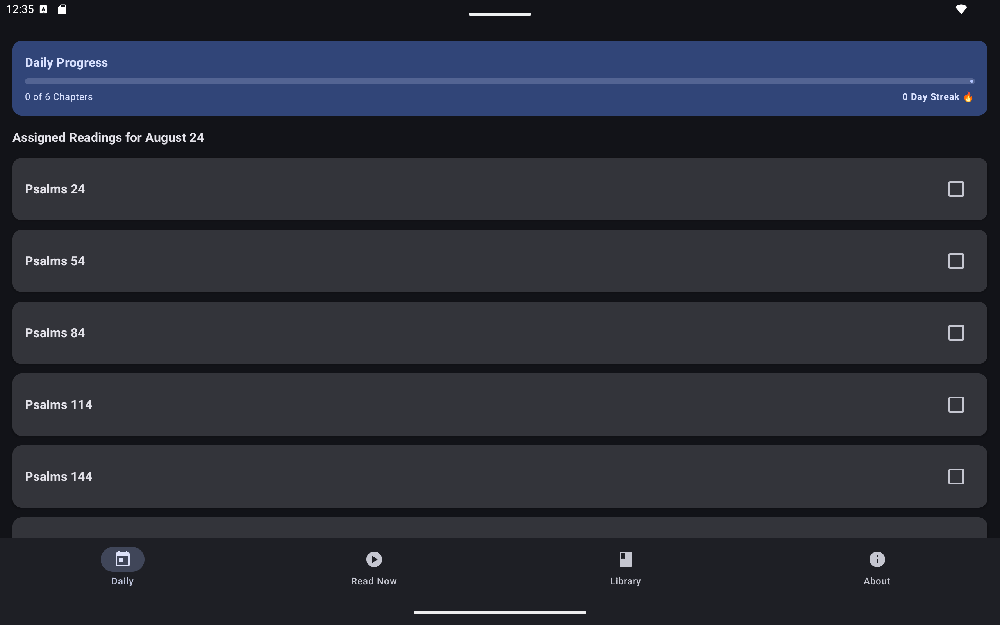
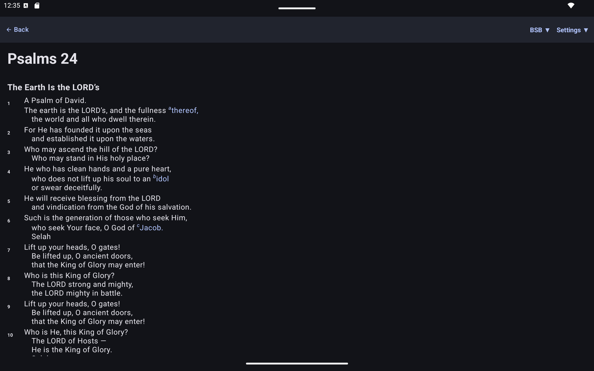
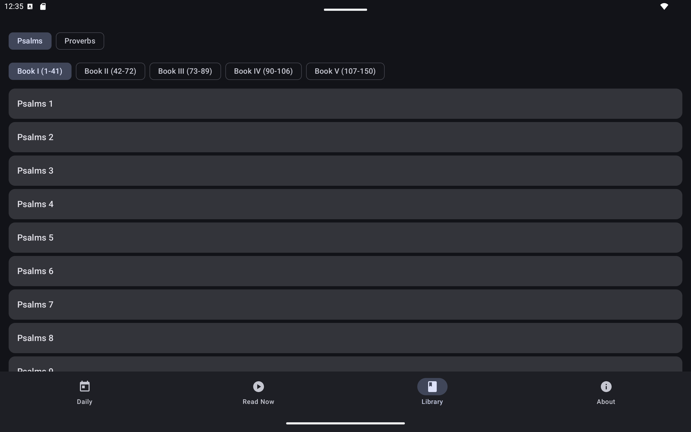
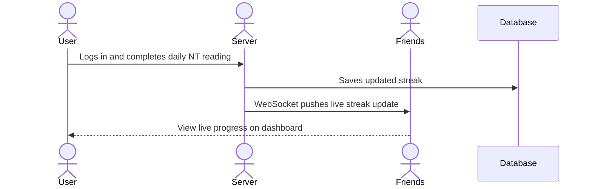

# NT Connect

> A React reading companion that helps people build a consistent New Testament reading habit.

[Live site](https://peterhill.click) · [GitHub repository](https://github.com/CephasHill/startup) · [Development notes](notes.md)

> **Project status:** Work in progress. The React frontend and core reading experience are functional, while backend persistence, authentication, and real-time social features remain planned course milestones.

## Project overview

NT Connect turns a structured New Testament reading plan into an approachable daily experience. Users can view assigned chapters, read the full New Testament, choose a translation, track progress, and explore social features designed to make reading more consistent and encouraging.

This project demonstrates a responsive React single-page application, client-side routing, reusable components, local state management with Context and Hooks, date-based reading logic, and a large set of structured Bible data. It was built as a BYU CS 260 project and developed incrementally through the course deliverables below.

## Highlights

- **Daily reading workflow:** Date-based chapter assignments, completion tracking, and streak-focused dashboard.
- **Reading experience:** Full New Testament navigation, chapter routes, verse numbering, footnotes, and translation selection.
- **Responsive interface:** Bootstrap and custom CSS create a consistent experience across desktop and mobile layouts.
- **Social direction:** Friends and activity views provide the foundation for shared progress and verse sharing.
- **Maintainable structure:** React components are organized by feature, with shared settings and progress managed through context providers.

## Run locally

```bash
npm install
npm run dev
```

Then open the local URL printed by Vite. A production build can be created with `npm run build`.

## Elevator pitch

Building a daily Bible reading habit is hard to do entirely alone. NT Connect takes a structured New Testament reading plan and turns it into a clear, encouraging daily workflow. Users can explore assigned chapters, track their reading progress, choose a translation, and browse the foundation for future friend activity and verse sharing. The project is designed to turn a typically solitary activity into a supportive, community-driven habit as its service and real-time features continue to evolve.

## Design and user experience


The home dashboard features a top-level progress bar, a live streak counter, and an interactive checklist of assigned readings for the current day.


The active reading interface provides a clean, readable canvas for the biblical text, complete with verse numbers, footnote support, and dropdowns for translation selection and user settings.


The library view allows users to seamlessly browse and navigate any part of the New Testament outside their assigned daily reading plan via a categorical tab system.



## Key features

- Authentication foundation: A dedicated login experience and course-planned registration and logout flow.
- Structured Reading Plans: Users can select different timelines to read the New Testament, such as the weekly 5x5 Weekday Plan (260 chapters over 52 weeks) or the 90-Day Sprint.
- Reading Interface: A clean, responsive library canvas to read chapters, complete with footnote support and multiple translations.
- Friends & Streaks foundation: A friends view and progress-focused dashboard are in place for the planned social experience.
- Real-Time Sharing roadmap: Verse highlighting and instant sharing are planned extensions of the current reading experience.

## Technologies and implementation

The current frontend is implemented with the following technologies. The backend, database, third-party API, and WebSocket items are documented as course targets in the deliverable sections below rather than presented as completed functionality.

- **HTML** - Semantic page structure supports the login, dashboard, reading, library, friends, and about views.
- **CSS and Bootstrap** - Responsive layouts, accessible contrast, reusable styles, and responsive navigation.
- **React and React Router** - A Vite-powered single-page application with feature-based components and route-based navigation.
- **React Context and Hooks** - Shared reading settings and progress state, including persistence in browser local storage.
- **Structured JSON data** - New Testament text and translation data are stored locally for fast chapter navigation without a network dependency.
- **Planned service integrations** - The original course design includes a Node.js service, MongoDB authentication and persistence, the [Bible API](https://bible-api.com/), and WebSocket updates for future social functionality.

## Course deliverables

The following sections preserve the implementation evidence and rubric checklist used for the CS 260 course.

### 🚀 Specification Deliverable

> [!NOTE]
> Fill in this sections as the submission artifact for this deliverable. You can refer to this [example](https://github.com/webprogramming260/startup-example/blob/main/README.md) for inspiration.

For this deliverable I did the following. I checked the box `[x]` and added a description for things I completed.

- [x] I completed the prerequisites for this deliverable (Git commit requirement) - *Created repository, regularly pushed commits across development, and linked `notes.md`.*
- [x] Proper use of Markdown - *Formatted using structured headers, inline bolding, lists, and an embedded Mermaid diagram.*
- [x] A concise and compelling elevator pitch - *Wrote an elevator pitch focusing on turning solitary Bible reading into a collaborative habit.*
- [x] Description of key features - *Detailed authentication, reading plans, reading UI, streaks, and real-time verse sharing.*
- [x] Description of how you will use each technology including your 3rd party API and use of WebSocket - *Specified the tech stack roles, including WebSocket live updates and the Unsplash API integration link.*
- [x] One or more rough sketches of your application. Images must be embedded in this file using Markdown image references. - *Embedded three design screenshots (Dashboard, Active Reading, and Library) with explanatory captions.*

### 🚀 AWS deliverable

For this deliverable I did the following. I checked the box `[x]` and added a description for things I completed.

- [x] **Rented EC2 server** - *I rented an EC2 server.*
- [x] **Leased domain name** - *I leased the domain peterhill.click.*
- [x] **Server accessible** from my domain: [https://peterhill.click](https://peterhill.click) - *My website is accessible and supports HTTPS protocol.*

### 🚀 HTML deliverable

For this deliverable I did the following. I checked the box `[x]` and added a description for things I completed.

- [X] I completed the prerequisites for this deliverable (Simon deployed, GitHub link, Git commits)
- [X] **HTML pages** - Added a total of 5 pages (home, read, library, friends, about) for each component of my application.
- [X] **Proper HTML element usage** - I used proper use of HTML tags including BODY, NAV, MAIN, HEADER, FOOTER.
- [X] **Links** - Each of my pages has a nav menu that links to every other page.
- [X] **Text** - My application contains textual content (i.e. John 1)
- [X] **3rd party API placeholder** - I added a placeholder for a 3rd party API service call.
- [X] **Images** - I added a placeholder image.
- [X] **Login placeholder** - I added a login placeholder.
- [X] **DB data placeholder** - My New Testament texts will be held in the DB, and I added John 1.
- [X] **WebSocket placeholder** - I added the friends page where users can interact with each other and see each other's progress.

### 🚀 CSS deliverable

For this deliverable I did the following. I checked the box `[x]` and added a description for things I completed.

- [X] I completed the prerequisites for this deliverable (Simon deployed, GitHub link, Git commits)
- [X] **Visually appealing colors and layout. No overflowing elements.** - I added a blue and white visual theme to the whole app. There are no overflowing elements.
- [X] **Use of a CSS framework** - I used Bootstrap to get buttons and things working and looking nice.
- [X] **All visual elements styled using CSS** - All visual elements are styled with CSS.
- [X] **Responsive to window resizing using flexbox and/or grid display** - Responsive window resizing uses flexbox.
- [X] **Use of a imported font** - I added Roboto as a font from Google Fonts.
- [X] **Use of different types of selectors including element, class, ID, and pseudo selectors** - I used element selectors (body, main, footer), class selectors (.navbar, .page-shell, .content-panel, .reader-frame, etc.), pseudo-class selectors (.navbar-brand:hover, .nav-link:hover, .nav-link:active), descendant selectors (.hero-panel h1, .content-panel h2), and an ID selector (#live-updates) for the unique live activity region.

### 🚀 React part 1: Routing deliverable

For this deliverable I did the following. I checked the box `[x]` and added a description for things I completed.

- [X] I completed the prerequisites for this deliverable (Simon deployed, GitHub link, Git commits)
- [X] **Bundled using Vite** - I bundled my project using Vite.
- [X] **Components** - I ported my components to use React.
- [X] **Router** - I refactored my code to use React to route the app between its pages.

### 🚀 React part 2: Reactivity deliverable

For this deliverable I did the following. I checked the box `[x]` and added a description for things I completed.

- [X] I completed the prerequisites for this deliverable (Simon deployed, GitHub link, Git commits)
- [X] **All functionality implemented or mocked out** - I separated the login from the home screen, including implementing home screen logic. I implemented the date-based assigned readings, including them in the Home and Read screens, meaning they display the correct reading for the day and allow the user to navigate to them easily and check them off when finished. I added the rest of the New Testament books, including parsing them from .usj files and converting them into usable JSON files. I changed the library screen to be aesthetically pleasing and added functionality to navigate the whole New Testament. I added support for the KJV, including parsing biblegateway.com for the text and converting it into usable JSON files. I implemented a mock friend activity live feed.
- [X] **Hooks** - I used hooks throughout the project including:
  - Storing the completed readings for the day.
  - Storing the chosen reading plan and Bible translation.
  - Storing the reading progress in the Library page.
  - Tracking the Library Browse Bible menu visibility, including listening for the Escape key to close it.

### 🚀 Service deliverable

For this deliverable I did the following. I checked the box `[x]` and added a description for things I completed.

- [ ] I completed the prerequisites for this deliverable (Simon deployed, GitHub link, Git commits)
- [ ] **Node.js/Express HTTP service** - I did not complete this part of the deliverable.
- [ ] **Static middleware for frontend** - I did not complete this part of the deliverable.
- [ ] **Calls to third party endpoints** - I did not complete this part of the deliverable.
- [ ] **Backend service endpoints** - I did not complete this part of the deliverable.
- [ ] **Frontend calls service endpoints** - I did not complete this part of the deliverable.
- [ ] **Supports registration, login, logout, and restricted endpoint** - I did not complete this part of the deliverable.
- [ ] **Uses BCrypt to hash passwords** - I did not complete this part of the deliverable.

### 🚀 DB deliverable

For this deliverable I did the following. I checked the box `[x]` and added a description for things I completed.

- [ ] I completed the prerequisites for this deliverable (Simon deployed, GitHub link, Git commits)
- [ ] **Stores data in MongoDB** - I did not complete this part of the deliverable.
- [ ] **Stores credentials in MongoDB** - I did not complete this part of the deliverable.

### 🚀 WebSocket deliverable

For this deliverable I did the following. I checked the box `[x]` and added a description for things I completed.

- [ ] I completed the prerequisites for this deliverable (Simon deployed, GitHub link, Git commits)
- [ ] **Backend listens for WebSocket connection** - I did not complete this part of the deliverable.
- [ ] **Frontend makes WebSocket connection** - I did not complete this part of the deliverable.
- [ ] **Data sent over WebSocket connection** - I did not complete this part of the deliverable.
- [ ] **WebSocket data displayed** - I did not complete this part of the deliverable.
- [ ] **Application is fully functional** - I did not complete this part of the deliverable.
